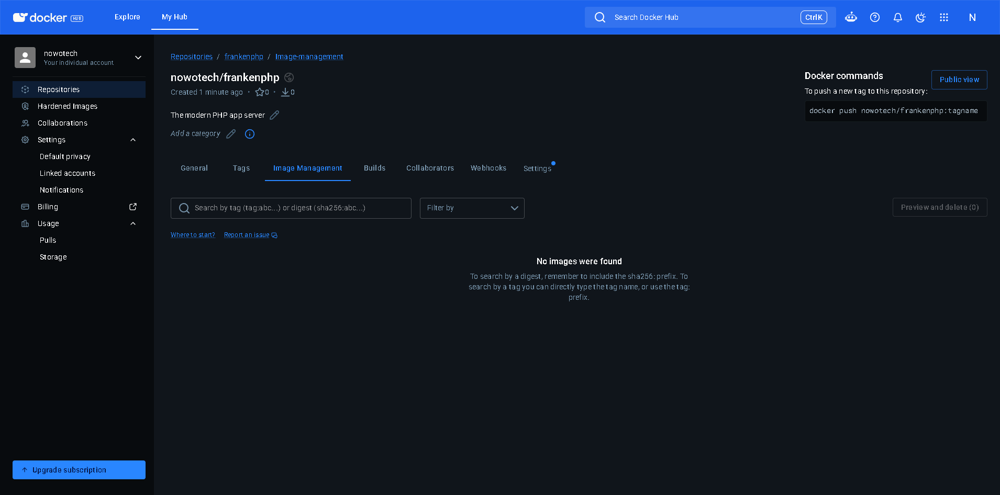
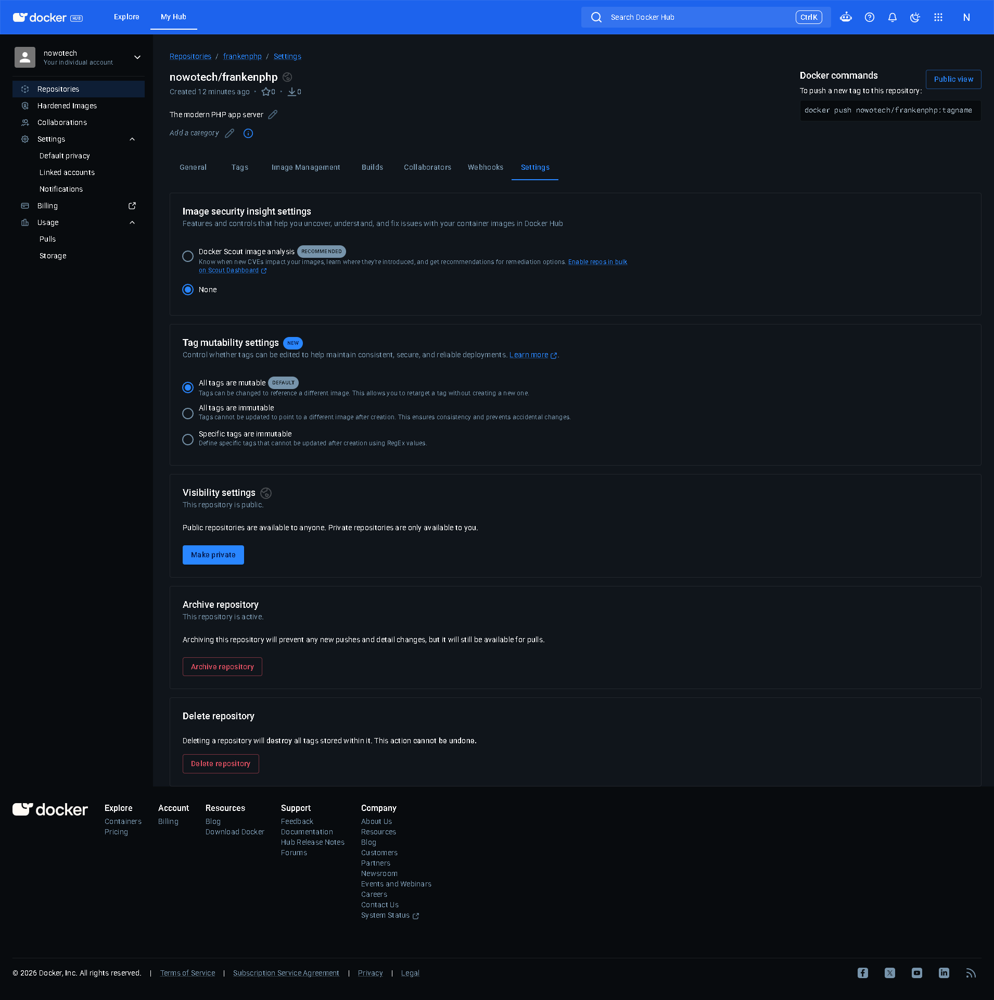
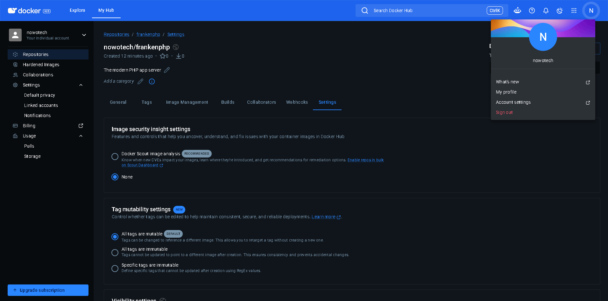
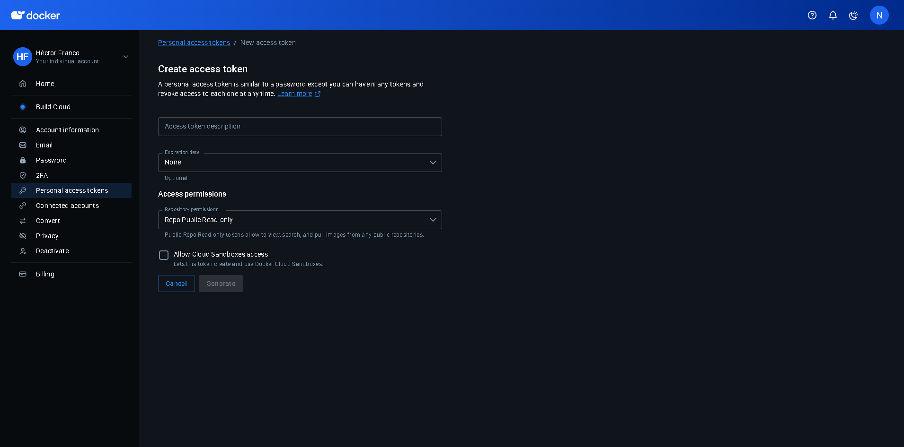
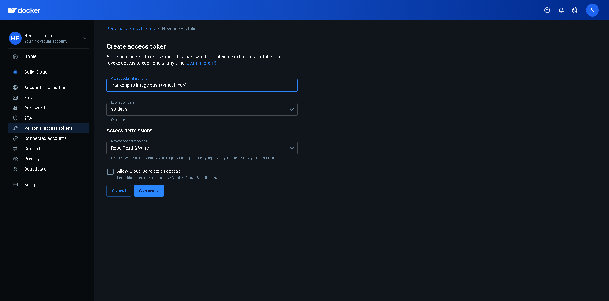

# Publishing the image on Docker Hub (public)

Step-by-step guide to build `frankenphp:1.13.5-php8.5.13-alpine` and publish it as a **public** repository on Docker Hub.
Screenshots go in [`screenshots/`](screenshots/) and are linked from each step (``).

> Never commit or paste tokens. The Docker Hub access token lives only in your password manager and in
> `docker login`'s credential store.

---

## 0. Requirements

- Docker with `buildx` (`docker buildx version`).
- `make`, `git`, `curl`.
- A Docker Hub account (free plan is enough for public repositories).

---

## 1. Create the Docker Hub account (skip if you have one)

1. Open <https://hub.docker.com/signup> and sign up.
2. Confirm the e-mail address.
3. Note your **username** — it is the image namespace (`<username>/frankenphp`).

<!--  -->

---

## 2. Create the public repository

1. Sign in at <https://hub.docker.com>.
2. **Repositories → Create a repository**.
3. Fill in:
   - **Namespace**: your user (or organisation).
   - **Repository name**: `frankenphp`.
   - **Short description**: `FrankenPHP 1.13.5 on PHP 8.5.13 (Alpine), built from the upstream Dockerfile`.
   - **Visibility**: **Public**.
4. **Create**.

Result: the empty repository page (`nowotech/frankenphp`, *No images were found* under **Image Management**).
The `docker push nowotech/frankenphp:tagname` hint on the right is what `make push` runs for you.



5. Check **Settings → Visibility settings** says *This repository is public.* (the button offers **Make private**).
   Leave **Image security insight** and **Tag mutability** at their defaults.



> Pushing to a repository that does not exist also creates it, but as your account's default visibility.
> Creating it first makes sure it is public.

---

## 3. Create an access token

Use a token instead of your password for `docker login`.

> **Docker Desktop already signed in?** Docker Desktop creates its own token
> (*Generated through desktop…*, Repo Read, Write, Delete) and `docker push` uses it. If `docker push` works,
> you can skip steps 3 and 4. A dedicated token is still better for CI or a server.

1. Avatar (top right) → **Account settings** (opens `app.docker.com`).

   

2. Left menu → **Personal access tokens** → **Generate new token**.
3. Fill in the form:
   - **Access token description**: `docker-frankenphp push (<machine>)`.
   - **Expiration date**: e.g. 90 days (default *None* = never expires; avoid it).
   - **Repository permissions**: change the default **Repo Public Read-only** to **Read & Write**.
     Read-only cannot push; Delete is not needed.
   - **Allow Cloud Sandboxes access**: leave unchecked.

   

   Filled in (90 days, **Repo Read & Write**: *allow you to push images to any repository managed by your account*):

   

4. **Generate** and copy the token. It is shown only once. Store it in your password manager.

---

## 4. Log in from the terminal

```bash
docker login -u <username>
```

Paste the token when it asks for the password (nothing is echoed). Expected output:

```text
$ docker login -u nowotech

i Info → A Personal Access Token (PAT) can be used instead.
         To create a PAT, visit https://app.docker.com/settings

Password:
Login Succeeded
```

The *Info* line is printed every time; it does not mean the token was rejected.

---

## 5. Set your namespace

Edit `versions.env` and replace `CHANGE_ME`:

```dotenv
DOCKERHUB_USER=<username>
```

(Or pass `DOCKERHUB_USER=<username>` to every `make` command.)

---

## 6. Build locally

```bash
make build
```

What it does:

1. `make fetch` clones `php/frankenphp` at tag `v1.13.5` into `.upstream/` and checks the pinned commit.
2. `make build-base` runs the **upstream `alpine.Dockerfile`** (`runner` target) with
   `php-base = php:8.5.13-zts-alpine` and `golang-base = golang:1.27-alpine`,
   the same contexts `dunglas/frankenphp` uses in its `docker-bake.hcl`.
3. `make build-symfony` adds the common Symfony extensions and Composer.

First build: ~10–15 minutes (FrankenPHP and the file watcher are compiled from source).

<!--  -->

---

## 7. Test before publishing

```bash
make test
```

Checks:

- `frankenphp version` prints `FrankenPHP v1.13.5 PHP 8.5.13 Caddy ...`;
- `php -v` reports **8.5.13**;
- the Symfony tag has `intl`, `pdo_pgsql`, `redis`, `apcu`, `zip` and Composer;
- a container answers `HTTP 200` on port 80.

<!--  -->

---

## 8. Push

### Option A — local platform only (amd64), fast

```bash
make push
```

Pushes `1.13.5-php8.5.13-alpine` and `1.13.5-php8.5.13-alpine-symfony` (every local tag of the image).

### Option B — multi-arch (amd64 + arm64), recommended for a public image

Upstream alpine images cover amd64, 386, arm/v6, arm/v7 and arm64. To also serve Apple Silicon / ARM servers:

```bash
# once: QEMU emulators + a builder that supports multi-platform
docker run --privileged --rm tonistiigi/binfmt --install arm64
docker buildx create --name multiarch --use

make push-multiarch                      # default: linux/amd64,linux/arm64
```

The arm64 build runs under emulation: expect 45–90 minutes. It builds and pushes in one step
(multi-platform images are not loaded into the local Docker).

<!--  -->

---

### Option C — GitHub Actions (amd64 + arm64 on native runners)

Source repo: <https://github.com/nowo-tech/docker-frankenphp>.

1. GitHub repo → **Settings → Secrets and variables → Actions**:
   - **Variables → New repository variable**: `DOCKERHUB_USER` = `nowotech`.
   - **Secrets → New repository secret**: `DOCKERHUB_TOKEN` = the Read & Write token from step 3.
2. Push a tag: `git tag v1.13.5-php8.5.13 && git push origin v1.13.5-php8.5.13`
   (or **Actions → build → Run workflow**).
3. The `build` jobs compile on amd64 and arm64 in parallel (~15 min); `merge` creates the multi-arch tags.

<!--  -->

---

## 9. Check on Docker Hub

1. Open `https://hub.docker.com/r/<username>/frankenphp/tags`.
2. Each tag shows its **OS/ARCH** (one row, or two with multi-arch) and the compressed size.
3. From any machine, without logging in:

   ```bash
   docker pull <username>/frankenphp:1.13.5-php8.5.13-alpine
   docker run --rm <username>/frankenphp:1.13.5-php8.5.13-alpine php -v
   ```

<!--  -->

---

## 10. Repository overview (README on Docker Hub)

1. Repository page → **General → Repository overview → Edit**.
2. Paste the content of this repo's `README.md` (tags table and usage) and save.

<!--  -->

---

## 11. Use it in a project

```dockerfile
FROM <username>/frankenphp:1.13.5-php8.5.13-alpine AS frankenphp_upstream
# or the Symfony-ready variant:
# FROM <username>/frankenphp:1.13.5-php8.5.13-alpine-symfony
```

When upstream publishes `dunglas/frankenphp:1.13.5-php8.5.13-alpine` (or a newer patch), switch back to upstream.

---

## 12. New versions

1. Update `versions.env` (`PHP_VERSION`, and/or `FRANKENPHP_VERSION` + `FRANKENPHP_COMMIT`).
   Get the commit with `git ls-remote https://github.com/php/frankenphp.git refs/tags/vX.Y.Z`.
2. `make clean build test`, then `make push` or `make push-multiarch`.
3. Never overwrite an existing tag with different content; publish a new tag.

---

## Troubleshooting

| Symptom | Fix |
|---------|-----|
| `denied: requested access to the resource is denied` | Not logged in, wrong namespace in `DOCKERHUB_USER`, or token is Read-only. |
| `Upstream commit mismatch` | The tag in `.upstream/` is not the pinned one: `make clean fetch`. |
| `failed to resolve e-dant/watcher tarball URL (rate limited?)` | GitHub API rate limit. Wait, or `export GITHUB_TOKEN=...` and add `--secret id=github-token,env=GITHUB_TOKEN` to the build. |
| `multiple platforms feature is currently not supported for docker driver` | Run the `docker buildx create --name multiarch --use` step. |
| Pull is slow / `toomanyrequests` | Docker Hub anonymous pull limit: `docker login` on that machine. |
